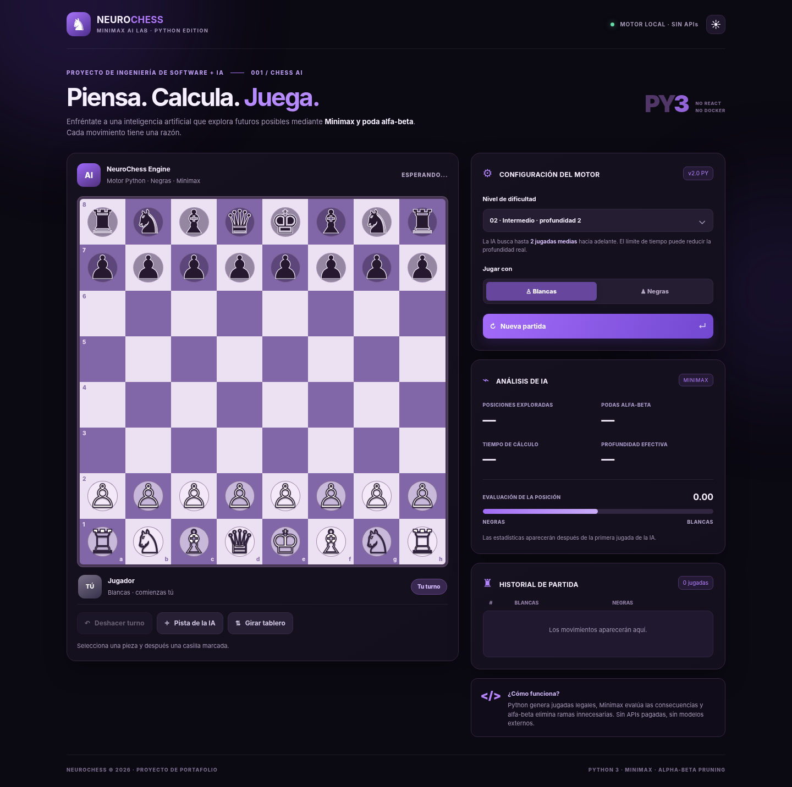

# ♞ NeuroChess | Minimax AI Lab (Python Edition)

**Un proyecto de portafolio de Ingeniería de Software con IA:** ajedrez jugable
contra un motor Minimax programado en Python, con poda alfa-beta, movimientos
legales y una interfaz oscura violeta adaptable a computadoras y celulares.



## ¿Qué se corrigió de la versión anterior?

- **64 casillas cuadradas**, siempre de idénticas dimensiones. Una cuadrícula
  CSS de `8 × 8` con filas y columnas explícitas y `aspect-ratio: 1` evita
  que filas vacías se contraigan.
- **Blancas siempre empiezan**, de acuerdo con las reglas del ajedrez.
  La orientación predeterminada muestra las blancas abajo y se invierte si
  eliges negras. La IA juega primero con blancas si tú eliges negras.
- **Piezas distinguibles:** glifos diferentes, rellenos y contornos separados
  para las piezas blancas y negras.
- **Ya no hay React, Vite, npm, Node ni Docker.** El backend y el motor son Python;
  el navegador usa HTML, CSS y un poco de JavaScript nativo para el tablero.

## Ejecutar en Windows o Linux

Solo necesitas **Python 3.10 o superior**. No hay que instalar librerías.

```bash
python app.py
```

Abre **http://localhost:8000** en el navegador. Para detenerlo, presiona
`Ctrl+C`. En Windows, si `python` no existe, intenta `py app.py`.

> **Importante:** no abras el archivo `static/index.html` directamente con
> doble clic: la página se comunica con las rutas `/api/` del servidor Python.

## Funcionalidades

- Jugar como **blancas** o como **negras** contra IA.
- Cuatro dificultades (profundidad 1–4) con **búsqueda iterativa**. Cuando el
  presupuesto de tiempo se cumple, se usa la última profundidad finalizada.
- Reglas reales: movimientos legales, jaque, jaque mate, ahogado, enroque,
  captura al paso, coronación, material insuficiente, tablas por repetición
  y reglas de 50/75 jugadas según el caso.
- Historial de jugadas en notación SAN, **deshacer turno**, pista calculada por
  IA, voltear tablero, elección de promoción, tema claro y oscuro.
- Panel de análisis con **nodos explorados, cortes alfa-beta, tiempo, profundidad
  efectiva** y evaluación desde el punto de vista de las blancas.
- Interfaz responsive, sin imágenes externas, sin cuentas y sin claves API.

## Arquitectura

```text
neurochess-python/
├── app.py                # HTTP, API y sesiones de partida (stdlib)
├── chess_core.py         # Reglas completas y estado en notación FEN
├── ai.py                 # Evaluación, Minimax, alfa-beta y métricas
├── static/
│   ├── index.html        # Vista principal
│   ├── styles.css        # Tema morado oscuro, claro, tablero 8 × 8
│   ├── app.js            # Interacción (JavaScript nativo, sin React)
│   └── favicon.svg
├── tests/test_chess.py   # Pruebas automatizadas con unittest
├── docs/                 # Capturas para mostrar en el portafolio
├── render.yaml           # Despliegue público en Render
├── .gitignore
└── README.md
```

### Cómo funciona Minimax

1. El jugador selecciona una casilla y el frontend consulta las jugadas
   legales enviadas por el servidor Python.
2. `chess_core.py` comprueba cada jugada antes de aplicarla.
3. `ai.py` genera un **árbol de jugadas** hasta la profundidad del nivel.
4. Blancas maximizan la evaluación; negras la minimizan. **Alfa-beta** descarta
   ramas que ya no pueden mejorar el resultado.
5. La función heurística evalúa **material**, desarrollo, estructura/avance
   de peones, centralización y seguridad básica del rey.
6. La API devuelve el movimiento legal elegido junto a estadísticas reales.

**Datos técnicos:** `alpha` es el límite inferior, `beta` el superior. Si
`alpha ≥ beta`, la rama se poda. En el peor caso, la búsqueda crece
aproximadamente como `O(b^d)` para factor de ramificación `b` y profundidad
`d`; con muy buena ordenación la poda puede ahorrar una gran parte del árbol.
El código no utiliza Stockfish ni modelos de lenguaje. Minimax es una técnica
clásica de inteligencia artificial simbólica.

### API

| Método | Ruta | Uso |
|---|---|---|
| GET | `/api/health` | Comprobar el servidor |
| POST | `/api/new` | Nueva partida (`player`, `difficulty`) |
| POST | `/api/move` | Jugada del jugador (`game_id`, `move` UCI) |
| POST | `/api/ai` | Calcular y realizar jugada de IA |
| POST | `/api/hint` | Sugerencia para el jugador |
| POST | `/api/undo` | Deshacer turno del jugador y respuesta IA |
| POST | `/api/claim-draw` | Reclamar tablas cuando sea válido |
| POST | `/api/state` | Consultar estado actual |

## Pruebas automatizadas

```bash
python -m unittest discover -s tests -v
```

Las pruebas cubren el tablero inicial (20 jugadas legales), la referencia de
perft a profundidad 3 (8.902 posiciones), turno inicial, coronación, enroque,
captura al paso, mate, tablas, resultados legales de Minimax y flujo de API.

## Publicar gratis en Render

**GitHub Pages NO puede ejecutar este proyecto** por sí solo porque utiliza un
servidor Python, no solo archivos estáticos. Puedes guardar el código en GitHub
y publicarlo desde un servicio web de Python compatible.

1. Sube el contenido de esta carpeta a un repositorio nuevo de GitHub.
2. En [Render](https://dashboard.render.com/), crea **New → Blueprint** y elige
   tu repositorio. Render leerá el archivo `render.yaml` incluido.
3. Autoriza la creación del servicio web y abre la dirección pública de Render
   una vez termine el despliegue.
4. Pon esa URL como enlace **Demo** en tu portafolio; el repositorio como
   enlace **Código**.

También puedes desplegar como **Web Service** manual con:

- **Runtime:** Python
- **Build command:** `python -m compileall -q .`
- **Start command:** `python app.py`
- **Health check:** `/api/health`

El servidor escucha `0.0.0.0` y toma el puerto de la variable `PORT` del
proveedor, por lo que no requiere cambiar el código. El plan gratuito de
Render puede suspender el servicio por inactividad y tiene límites de CPU;
el nivel experto puede demorar más según el proveedor.

```bash
# Ejemplo desde la carpeta que contiene app.py:
git init
git add .
git commit -m "feat: NeuroChess Minimax Python"
git branch -M main
# Crea antes un repositorio vacío en GitHub y reemplaza TU-USUARIO y TU-REPO:
git remote add origin https://github.com/TU-USUARIO/TU-REPO.git
git push -u origin main
```

## Descripción lista para tu portafolio

> **NeuroChess — Motor de ajedrez con Inteligencia Artificial.** Desarrollé una
> aplicación web interactiva respaldada por Python y un motor de búsqueda
> Minimax con poda alfa-beta. Implementé generación y validación de jugadas
> legales, reglas oficiales, evaluación heurística, distintos niveles de
> dificultad y un panel de métricas para visualizar el comportamiento de la IA.
> Tecnologías: Python, algoritmos de búsqueda, HTML5, CSS3 y JavaScript.

## Alcance y limitaciones

Este es un **motor didáctico y funcional para portafolio**, no un reemplazo de
Stockfish. Profundidad máxima 4, sin libro de aperturas, sin tabla de
transposiciones persistente y sin bases de datos. Las partidas se mantienen en
memoria durante el funcionamiento del servidor y se pierden si el proceso
se reinicia o el servidor gratuito se suspende. En una aplicación de alta
concurrencia convendría un servidor y almacenamiento más robustos.

Código bajo licencia MIT.
